<h1 align="center">Fuck what i doing with my life</h1>

<p align="center">
  
</p>

<p align="center">
  
  
</p>

<p align="center">
  
</p>

---

## 👋 About me

Low-level enjoyer. Linux user. Open-source tinkerer.
I write code, break things, and occasionally figure out why.

- 🌍 Based in **Russia**
- 💻 Daily drivers: **C**, **C++**, **Shell**
- 🎮 Into **DDNet** / **Teeworlds** / **Linux** / **open source**
- 💜 Trying to write better code (slowly)

```console
ila@archlinux ~ $ cat ~/.config/ddnet/settings_ila.cfg
player_name    "ILA"
role           "low-level enjoyer"
location       "Russia"
languages      "C, C++, Shell, a bit of Python"
hobby          "breaking things, then figuring out why"
cl_motivation  0   # still ships anyway
```

---

## 🎮 What I'm building

| Project | What it is |
|---|---|
| 🟣 **[BestClient](https://github.com/ILA-dd/BestClient)** | DDNet client — *«Best Client for Best Players»* |
| 🐭 **[MosseratClient](https://github.com/ILA-dd/MosseratClient)** | DDNet client fork with demo editing and Windows Vulkan builds |
| 📡 **[llupat_bot](https://github.com/ILA-dd/llupat_bot)** | Tracker of DDNet players |
| 📷 **[hyprland-dual-camera](https://github.com/ILA-dd/hyprland-dual-camera)** | Two cameras on Hyprland, in C++ |
| 🐧 **[arch-setup](https://github.com/ILA-dd/arch-setup)** | My Arch install & rice in one script |

---

## 🛠 Tech & tools

<p align="left">
  
  
  
  
  
  
  
</p>

---

## 💬 Discord

<p align="left">
  <a href="https://discord.com/users/660719822199586818">
    
  </a>
</p>

<p align="center"><sub>no tees were frozen in the making of this README</sub></p>
